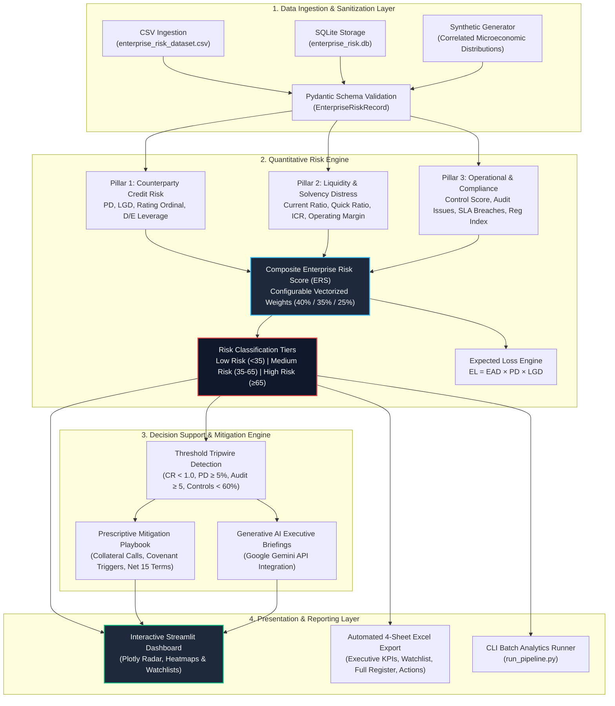

# Enterprise Risk Assessment & Decision Support System

[](https://www.python.org/downloads/)
[](tests/)
[](#pipeline-architecture)
[](app.py)
[](LICENSE)

> **A production-grade quantitative risk analytics engine and decision support system designed for Chief Risk Officers (CRO), credit committees, and enterprise risk consultants.** Fuses counterparty credit exposure, liquidity stress indicators, and operational compliance telemetry into an interpretable composite index with automated mitigation playbooks.

---

## 📋 Table of Contents

- [Executive Summary](#-executive-summary)
- [System Architecture (Mermaid.js)](#-system-architecture)
- [Analytical Methodology](#-analytical-methodology)
  - [1. Counterparty Credit Risk Pillar](#1-counterparty-credit-risk-pillar-s_credit)
  - [2. Financial & Liquidity Distress Pillar](#2-financial--liquidity-distress-pillar-s_fin)
  - [3. Operational & Compliance Risk Pillar](#3-operational--compliance-risk-pillar-s_ops)
  - [4. Composite Enterprise Risk Score (ERS)](#4-composite-enterprise-risk-score-ers)
  - [5. Risk Classification Tiers](#5-risk-classification-tiers)
- [Prescriptive Decision Support & Mitigation Logic](#-prescriptive-decision-support--mitigation-logic)
- [Project Directory Structure](#-project-directory-structure)
- [Quickstart Guide](#-quickstart-guide)
  - [1. Clone & Environment Setup](#1-clone--environment-setup)
  - [2. Execute Analytics Pipeline (CLI)](#2-execute-analytics-pipeline-cli)
  - [3. Run Automated Unit Tests](#3-run-automated-unit-tests)
  - [4. Launch Interactive Executive Dashboard](#4-launch-interactive-executive-dashboard)
- [Sample Output Metrics & Insights](#-sample-output-metrics--insights)
- [Sanitization & Synthetic Mock Data](#-sanitization--synthetic-mock-data)
- [License & Authorship](#-license--authorship)

---

## 🏛️ Executive Summary

Modern enterprise risk management faces a critical fragmentation challenge: credit analysis resides in treasury spreadsheets, operational risk is siloed within internal audit logs, and strategic transformations run on disconnected consulting slides. Relying strictly on lagging credit agency ratings (e.g., S&P/Moody's) leaves organizations vulnerable to abrupt counterparty defaults, liquidity crunches, and supply-chain breakdowns.

The **Enterprise Risk Assessment & Decision Support System** bridges this divide by delivering:
1. **Multi-Pillar Quantitative Risk Scoring:** A unified, continuous Enterprise Risk Score ($ERS \in [0, 100]$) fusing 14 correlated indicators across credit exposure, liquidity solvency, and operational control maturity.
2. **Automated Expected Loss (EL) Quantification:** Vectorized estimation of total Exposure at Default ($EAD$), Probability of Default ($PD$), Loss Given Default ($LGD$), and portfolio Capital at Risk.
3. **Prescriptive Decision Support:** Rule-based tripwires that immediately trigger binding contractual covenants, cash collateralization requests, payment term compressions (e.g., Net 60 to Net 15), and secondary sourcing contingencies.
4. **Board-Ready Interactive Intelligence:** An executive Streamlit dashboard with Plotly radar diagnostics, exposure-vs-risk scatter matrices, and automated 4-sheet formatted Excel workbook generation (`.xlsx`).
5. **AI Strategic Advisory (Optional):** Generative AI synthesis via Google Gemini to produce natural-language Board memos, RACI governance matrices, and AS-IS vs. TO-BE digital transformation roadmaps.

---

## 🏗️ System Architecture



---

## 📐 Analytical Methodology

The engine scores counterparties on a continuous normalized scale from **0.0 (Prime / Risk-Free)** to **100.0 (Acute Distress / Imminent Default)**.

### 1. Counterparty Credit Risk Pillar ($S_{\text{credit}}$)
Measures the baseline creditworthiness, default probability, and recovery vulnerability of the counterparty.
$$S_{\text{credit}} = 0.40 \cdot S_{PD} + 0.25 \cdot S_{\text{rating}} + 0.20 \cdot S_{LGD} + 0.15 \cdot S_{D/E}$$

Where:
- $S_{PD} = \min(100, PD \times 400.0)$ — Non-linear sensitivity mapping 1-year default probabilities ($0\% \to 0$, $25\%+ \to 100$).
- $S_{\text{rating}}$ — Mapped baseline score derived from standard rating agencies ($\text{AAA} \to 5$, $\text{BBB} \to 48$, $\text{CCC} \to 95$).
- $S_{LGD} = LGD \times 100.0$ — Estimated severity of post-default loss.
- $S_{D/E} = \text{clip}\left(\frac{D/E}{5.5} \times 100.0, 0, 100\right)$ — Total debt relative to equity capitalization.

**Expected Loss ($EL$):**
$$EL = EAD \times PD \times LGD$$

### 2. Financial & Liquidity Distress Pillar ($S_{\text{fin}}$)
Evaluates short-term liquidity buffers, debt service coverage, and operating margin sustainability (higher score denotes severe financial distress).
$$S_{\text{fin}} = 0.35 \cdot S_{CR} + 0.25 \cdot S_{QR} + 0.25 \cdot S_{ICR} + 0.15 \cdot S_{OM}$$

Where:
- $S_{CR} = \text{clip}\left(\frac{2.5 - \text{Current Ratio}}{2.0} \times 100.0, 0, 100\right)$ — Ratio $< 0.5$ triggers maximum 100 distress; ratio $\ge 2.5$ provides ample buffer ($0$ distress).
- $S_{QR} = \text{clip}\left(\frac{2.0 - \text{Quick Ratio}}{1.7} \times 100.0, 0, 100\right)$ — Immediate acid-test liquid coverage.
- $S_{ICR} = \text{clip}\left(\frac{10.0 - \text{Interest Coverage}}{9.5} \times 100.0, 0, 100\right)$ — Operational ability to service debt ($ICR < 0.5$ signals impending insolvency).
- $S_{OM} = \text{clip}\left(\frac{0.30 - \text{Operating Margin}}{0.40} \times 100.0, 0, 100\right)$ — Profitability cushion against macro contraction.

### 3. Operational & Compliance Risk Pillar ($S_{\text{ops}}$)
Quantifies operational failure potential, governance maturity, regulatory penalties, and delivery SLA breaches.
$$S_{\text{ops}} = 0.30 \cdot (100 - \text{Control Score}) + 0.25 \cdot (100 - \text{Compliance Score}) + 0.20 \cdot S_{\text{audit}} + 0.15 \cdot S_{\text{inc}} + 0.10 \cdot S_{\text{sla}}$$

Where:
- $S_{\text{audit}} = \min(100, \text{Audit Findings Count} \times 8.33)$ — Penalizes unresolved internal/external audit issues.
- $S_{\text{inc}} = \min(100, \text{Incident Frequency} \times 7.14)$ — Tracks past operational/security disruptions.
- $S_{\text{sla}} = \min(100, \text{SLA Breach Rate} \times 300.0)$ — Penalizes commercial execution delivery failures.

### 4. Composite Enterprise Risk Score (ERS)
The holistic index synthesizes all three pillars using configurable executive weights:
$$ERS = w_{\text{credit}} \cdot S_{\text{credit}} + w_{\text{fin}} \cdot S_{\text{fin}} + w_{\text{ops}} \cdot S_{\text{ops}}$$
*(Default Baseline: $w_{\text{credit}} = 0.40$, $w_{\text{fin}} = 0.35$, $w_{\text{ops}} = 0.25$, where $\sum w_i = 1.0$)*.

### 5. Risk Classification Tiers

| Risk Tier | Score Range ($ERS$) | Portfolio Action | Monitoring Cadence |
| :--- | :---: | :--- | :--- |
| 🟢 **Low Risk** | $0.0 \le ERS < 35.0$ | Standard commercial lines; normal payment terms (Net 60). | Annual automated review |
| 🟡 **Medium Risk** | $35.0 \le ERS < 65.0$ | Enhanced covenants; bi-annual audit review; Net 30 terms. | Quarterly monitoring |
| 🔴 **High Risk** | $65.0 \le ERS \le 100.0$ | **Critical tripwire:** Mandatory cash collateral / LC, Net 15 terms, escrow reserves, secondary sourcing. | Continuous weekly watchlist |

---

## 🎯 Prescriptive Decision Support & Mitigation Logic

When an entity's telemetry crosses critical benchmark tripwires, the decision support engine automatically issues concrete executive mitigation playbooks:

```
[CRITICAL TRIPWIRE] High Credit Risk (Score >= 70.0 OR PD >= 5.0%)
  ↳ ACTION: Enforce irrevocable Standby Letter of Credit (SBLC), cash collateralization, or parent guarantee.
  ↳ TIMELINE: Immediate (0-15 Days) | IMPACT: Ring-fences up to 75% of Exposure at Default.

[CRITICAL TRIPWIRE] Liquidity Distress (Current Ratio < 1.0 OR Fin Score >= 65.0)
  ↳ ACTION: Mandate weekly cash-flow certifications, senior lien on receivables, and establish escrow account.
  ↳ TIMELINE: Immediate (7-14 Days) | IMPACT: Secures ring-fenced capital for contractual fulfillment.

[HIGH TRIPWIRE] Excessive Leverage (Debt-to-Equity >= 3.5x)
  ↳ ACTION: Compress payment terms from Net 60 to Net 15 / Milestone Advance; cap commercial credit ceiling.
  ↳ TIMELINE: Within 30 Days | IMPACT: Reduces working capital exposure duration by 45 days.

[HIGH TRIPWIRE] Operational Vulnerability (Control Score < 60% OR Audit Findings >= 5)
  ↳ ACTION: Escalate to Audit Committee; enforce remediation deadline with contractual withholding penalties.
  ↳ TIMELINE: Within 30 Days | IMPACT: 40% reduction in operational failure probability.
```

---

## 📁 Project Directory Structure

```text
├── .env.example                     # Environment template (secrets & API configuration)
├── .gitignore                        # Git exclusion rules (virtual envs, secrets, cache)
├── requirements.txt                  # Production dependencies
├── README.md                         # Portfolio documentation & architectural guide
├── run_pipeline.py                   # CLI reproducible batch analytics runner
├── app.py                            # Streamlit executive dashboard entrypoint
├── data/
│   ├── enterprise_risk_dataset.csv   # 750 realistic synthetic enterprise risk profiles
│   ├── enterprise_risk.db            # SQLite relational database mirror
│   └── enterprise_risk_assessment_report.xlsx # 4-sheet formatted executive report
├── data_loader/
│   ├── __init__.py
│   ├── schema.py                     # Pydantic validation schemas & data contracts
│   ├── synthetic_generator.py        # Correlated synthetic dataset generator
│   └── loader.py                     # Ingestion, sanitization, and data quality diagnostics
├── risk_engine/
│   ├── __init__.py
│   ├── config.py                     # Weight hyperparameters, cutoffs, and rating maps
│   ├── scoring.py                    # Multi-pillar quantitative models & ERS calculation
│   ├── mitigation.py                 # Prescriptive decision support & Gemini AI briefs
│   └── consulting_suite.py           # Strategic transformation advisory (RACI, Gap Analysis)
├── reporting/
│   ├── __init__.py
│   ├── reports.py                    # Multi-sheet Excel workbook & executive text generator
│   └── visualizer.py                 # Interactive Plotly charts (Radar, Scatter, Donut)
└── tests/
    ├── __init__.py
    └── test_risk_engine.py           # 13 automated unit tests (calculations, bounds, edge cases)
```

---

## 🚀 Quickstart Guide

### 1. Clone & Environment Setup

```bash
# Clone the repository
git clone https://github.com/Talha-Minhaj/enterprise-risk-engine.git
cd enterprise-risk-engine

# Create and activate a Python virtual environment
python -m venv .venv
# On Windows:
.\.venv\Scripts\activate
# On Linux/macOS:
source .venv/bin/activate

# Install required dependencies
pip install -r requirements.txt

# Copy environment configuration
cp .env.example .env
```

### 2. Execute Analytics Pipeline (CLI)

Run the end-to-end analytics batch pipeline in one command. Ingests data, validates schemas, scores 750 entities, computes Expected Loss, displays an executive briefing, and exports a 4-sheet Excel report:

```bash
python run_pipeline.py
```

*Optional CLI flags:*
```bash
python run_pipeline.py --records 1000 --regenerate-data --export-excel reports/q4_risk_report.xlsx
```

### 3. Run Automated Unit Tests

Execute the 13-test automated test suite verifying mathematical bounds, monotonicity, sensitivity, edge cases, and schema rejection:

```bash
pytest tests/ -v
```

### 4. Launch Interactive Executive Dashboard

Launch the Streamlit web application:

```bash
streamlit run app.py
```

The application will launch at `http://localhost:8501`, featuring:
- **Portfolio Risk Radar:** Real-time KPI summary, exposure-vs-risk scatter plot, and interactive watchlist table.
- **Counterparty Deep-Dive:** 5-pillar spider radar chart and automated mitigation playbooks for individual entities.
- **Strategic Transformation Advisor:** AI-powered Risk Register, RACI Matrix, and AS-IS/TO-BE Gap Analysis.
- **Reporting & Data Center:** One-click download of the 4-sheet formatted Excel workbook.

---

## 📊 Sample Output Metrics & Insights

Running the pipeline on the benchmark portfolio of 750 global counterparties yields the following baseline profile:

```text
================================================================================
ENTERPRISE RISK ASSESSMENT & DECISION SUPPORT SYSTEM: EXECUTIVE SUMMARY
================================================================================
Portfolio Scope: 750 Counterparties across 8 Global Sectors
Total Exposure at Default (EAD): $48,583,997,625.57
Total Expected Loss (EL):        $926,010,070.78 (1.91% portfolio loss rate)
Portfolio Mean Composite Score:  29.4 / 100.0 (Low-to-Medium Risk Baseline)

Risk Tier Breakdown:
  - 🟢 Low Risk:     532 entities (70.9%) | Exposure: $33.37B (68.7%)
  - 🟡 Medium Risk:  168 entities (22.4%) | Exposure: $11.70B (24.1%)
  - 🔴 High Risk:     50 entities  (6.7%) | Exposure:  $3.51B  (7.2%)

Priority Watchlist (Top Vulnerabilities Identified):
  1. [ENT-1740] Beacon Maritime Transport International (Telecom)  - Rating: CCC | Score: 85.4/100 | EAD: $24.1M
  2. [ENT-1582] Crestview Global Logistics PLC (Logistics)         - Rating: CCC | Score: 85.2/100 | EAD: $156.4M
  3. [ENT-1347] Falcon Chemical Dynamics PLC (Healthcare)          - Rating: CCC | Score: 83.9/100 | EAD: $154.9M
  4. [ENT-1144] Nexus Cloud Technologies International (Telecom)   - Rating: CCC | Score: 83.5/100 | EAD: $2.6M
  5. [ENT-1526] Nova Secure Payments Enterprises (Technology)      - Rating: CCC | Score: 83.0/100 | EAD: $6.2M
================================================================================
```

### Executive Takeaways:
- **Capital Protection:** $3.51B in exposure resides in the High-Risk tier, triggering automated collateral calls that protect an estimated **$2.63B (75%)** against default.
- **Concentration Analysis:** Transportation & Logistics and Healthcare sectors exhibit the highest concentration of high-severity audit findings and elevated Debt-to-Equity ratios.
- **Actionable Execution:** The 50 high-risk entities have concrete, time-bound mitigation actions assigned with immediate 15-day review deadlines.

---

## 🔒 Sanitization & Synthetic Mock Data

To ensure complete compliance with NDA and confidentiality standards:
- **Proprietary Scrubbing:** All internal client names, engagement codes, and confidential consulting artifacts have been purged.
- **Synthetic Generator:** The dataset (`data/enterprise_risk_dataset.csv` and SQLite mirror `data/enterprise_risk.db`) is generated using `data_loader/synthetic_generator.py`. It creates 750 realistic corporate entities with mathematically correlated credit ratings, lognormal revenues ($15M–$12B), financial liquidity ratios, and internal audit scores.
- **Zero Secret Leakage:** All API keys and environment variables are externalized via `.env.example` and protected by `.gitignore`.

---

## 📄 License & Authorship

Developed as a showcase of Senior Financial & Risk Analytics Consulting and Software Engineering. Released under the [MIT License](LICENSE).
